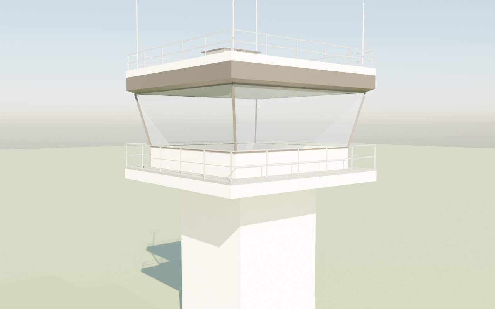
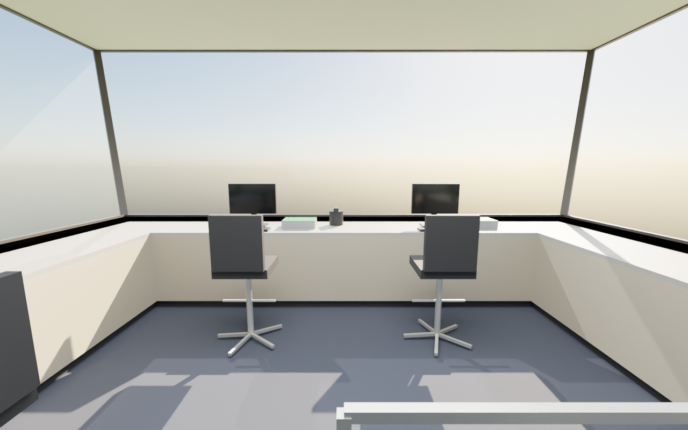

# Class D Generic Tower for MSFS 2024

A generic US Class D (VFR) control tower for Microsoft Flight Simulator 2024: a square,
four-sided cab with outward-leaning glass on every side, on a square concrete shaft. It is
built and loaded the same way as the VATFLOW KDCA cab in [`msfs-tower/`](../msfs-tower)
(a spawnable "aircraft" made from the SDK's SimpleAircraft sample), so that folder's
[SDK guide](../msfs-tower/SDK-GUIDE.md) applies step for step.

| Outside | Inside (from the stair well, looking out of the front window) |
| --- | --- |
|  |  |

## What's in the model

* **Cab**: 6.4 m (21 ft) square at the floor, 0.95 m solid sill, 2.45 m of glass leaning
  out 12 degrees, slim dark bronze corner mullions, a dark fascia band above the glass with
  a 30 cm overhang.
* **Outside**: a railed catwalk round all four sides, a flat roof with a low parapet and
  rail, an equipment house, three antenna masts and a wind sensor mast, and the square
  concrete shaft (8 m by default).
* **Inside**: carpet, an acoustic-tile ceiling with four light panels, a U of consoles along
  the front, right and left windows (grey laminate top, putty steel fronts), a monitor,
  radio panel and keyboard at each position, a light gun on the front console, three tower
  chairs, and the stair well with its guard rail at the back, between two low cabinets.
* About 1,300 triangles outside and 1,200 inside, plain PBR materials (no textures yet), all
  double sided.

Forward (the SimObject's nose) is the front window, Blender -Y. Origin = centre of the cab floor.

## Files

| File | What it is |
| --- | --- |
| `blender/build_class_d_tower.py` | Builds the tower in Blender from the parameters in `P = { ... }` at the top (cab size, glass height and lean, catwalk, fascia, shaft height, consoles). Two collections: `ClassD_Exterior` and `ClassD_Interior`. |
| `tools/export_gltf.py` | Runs the build headless and writes the ready-to-load models with the materials already set the way the sim needs them (no Blender export or MSFS material panel work). |
| `tools/render_preview.py` | Loads the exported glTF files back into Blender and renders `docs/exterior.png` / `docs/interior.png`. |
| `package/SimObjects/Airplanes/class_d_generic_tower/common/model/` | `model.cfg`, `class_d_tower.xml` / `.gltf` / `.bin` (exterior) and `class_d_tower_interior.xml` / `.gltf` / `.bin` (interior), already built. |

## Use it in MSFS 2024

Follow [msfs-tower/SDK-GUIDE.md](../msfs-tower/SDK-GUIDE.md) steps 1, 2, 7 and 8 with these
differences (steps 3 to 6, Blender and its exporter, aren't needed: the model files are
already in this folder):

1. **Model (step 8.1)**: put everything in
   `package/SimObjects/Airplanes/class_d_generic_tower/common/model/` into your
   SimpleAircraft copy's `common\model\` (move the sample's own files out first).
2. **Panel (step 8.2)**: skip it for now. This model has no live screens yet.
3. **Eye point (step 8.4)**: standing, 0.6 m (2.0 ft) forward of the cab centre, 5.4 ft up.
   For SimpleAircraft (`reference_datum_position = 3.6, 0, 0`):
   ```
   eyepoint = -1.6, 0, 5.4
   ```
4. **Name (step 8.5)**: `title = "Class D Generic Tower"`.
5. **Build All**, start a free flight with it, and place it on the sim's tower like the KDCA
   cab (`msfs-tower/placement/`, or slew mode). The 8 m shaft hangs down into the sim's own
   tower; to stand it on the ground at an airport with no tower, set `shaft_h` to the
   tower's height (Class D cabs are typically 15-25 m up) and rebuild.

## Change it and rebuild

Edit `P` in `blender/build_class_d_tower.py`, then (Blender 4.5 LTS, or the `bpy` module):

```
blender --background --python tools/export_gltf.py -- package/SimObjects/Airplanes/class_d_generic_tower/common/model
blender --background --python tools/render_preview.py -- package/SimObjects/Airplanes/class_d_generic_tower/common/model docs
```

Or open the build script in Blender's Scripting tab, run it, and export the two collections
with the MSFS Multi-Exporter as in the SDK guide (step 6), using the material values in
`PBR` in `tools/export_gltf.py`.

## Checked here, and what only the sim can confirm

The model was built with Blender 4.5 (`bpy` module), both glTF files pass the Khronos glTF
validator with no errors or warnings, and they load back into Blender (the preview pictures
are renders of the exported files). Loading it in MSFS 2024 itself hasn't been done yet; the
open points are the same as for the KDCA cab ([SDK guide](../msfs-tower/SDK-GUIDE.md#things-only-the-sim-can-confirm)).

## Next steps

* Live screens on the console monitors (the KDCA cab's DBRITE, TWR INFO and screen host),
  wired through a `panel.cfg` like `msfs-tower/package/.../common/panel/panel.cfg`.
* Textures (concrete, carpet, ceiling tiles) and a few more details from a reference photo.
