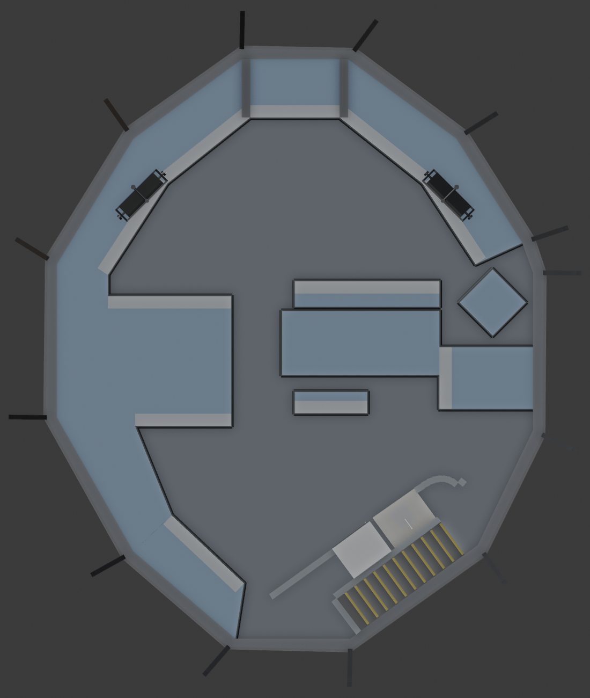
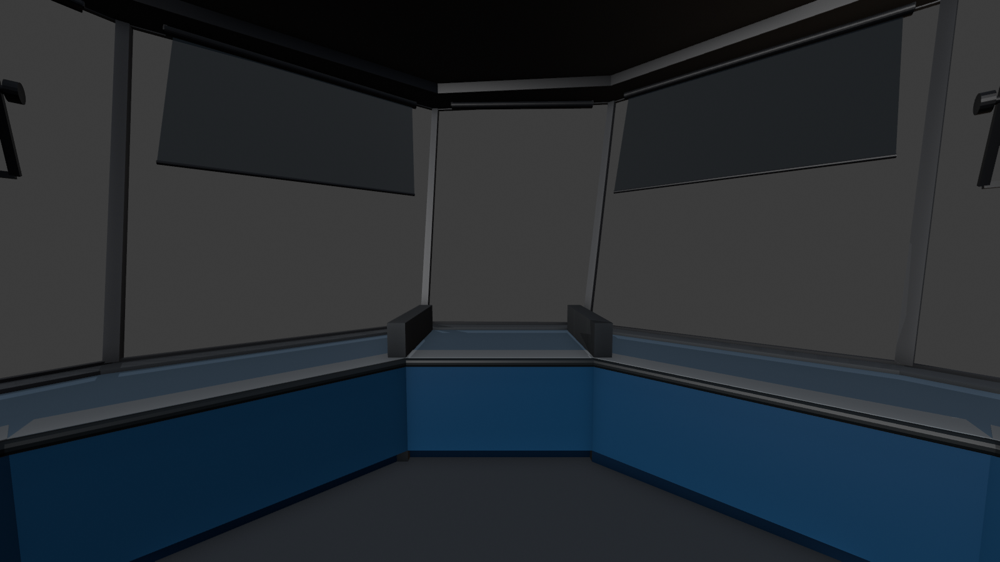
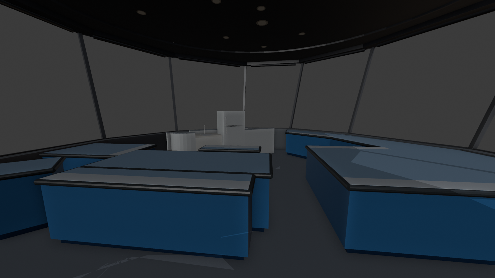
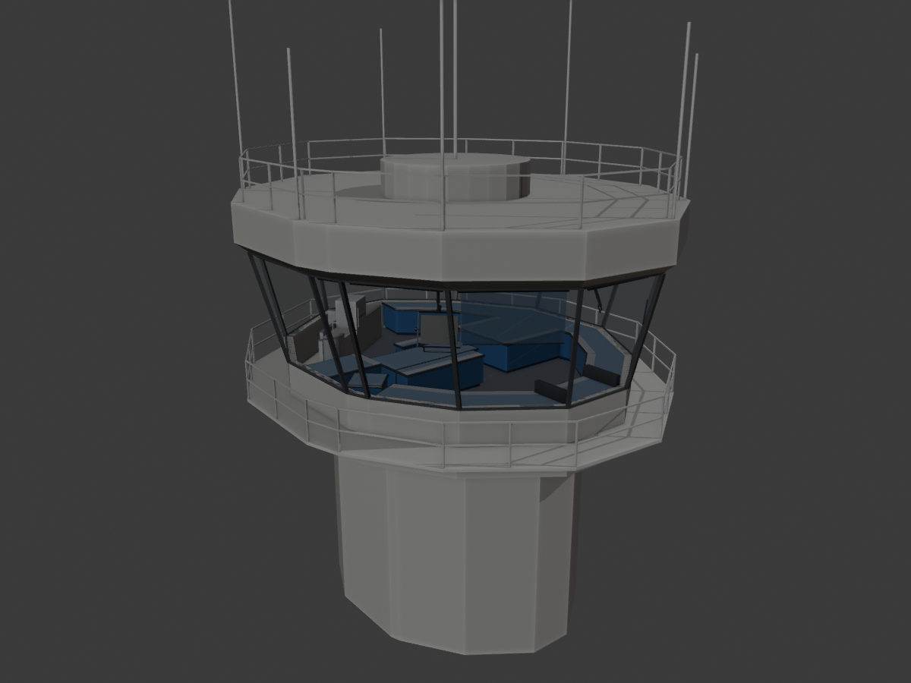

# DCA Tower Cab for MSFS 2024

A spawnable "aircraft" that is the Reagan National (KDCA) tower cab, built from the DCA cab's
equipment-view floor plan ([`docs/floor-plan.html`](docs/floor-plan.html)). Load it in MSFS
2024 like a plane, put it up on the tower from the **TOWER SETUP** screen, and work VATSIM
traffic from the GC position.

It is its own project, separate from the VATFLOW Tower Cab (`msfs-tower/`, on the
`claude/awesome-meitner-uhbs43` branch): its own folder, its own MSFS project and Community
package, its own SimObject (`vatflow_dca_tower_cab`) and its own copy of the screens
(`VatflowDcaTower`). Both cabs can be installed at once and updating one never touches the other.
It reuses that project's 3D work: the same console finish, the overhead monitors on their
ceiling track, the window shades and the screens.

| Floor plan (top down) | From GC | Into the cab |
| --- | --- | --- |
|  |  |  |



## What's in the cab

* **The DCA outline**: the plan's 13-sided wall, glass leaning out 15 degrees above a 95 cm sill,
  mullions at every corner. 8.5 m wide, 10.4 m front to back (the sheet's scale bar: 4 ft = 160 px).
* **GC front and centre**: GC (POS #3) is the front window, the SimObject's nose, so FWD on TOWER
  SETUP moves the cab towards GC's view and the default eye point stands at GC.
* **Every counter on the plan is a console**, built from its footprint and finished like the
  VATFLOW cab's: blue laminate worktop, 22 cm light grey writing strip along the edge the
  controller works at, dark bumper round every open edge, blue vent panels, dark kick plinth.
  * Perimeter: LCN #1, ALCN #2, GC #3, ALCS #4, LCS #5, TMTW #11, with the dark dividers at
    the front corners either side of GC.
  * Left island: the wall-side block with HC #6 at its top edge, the HC / FD #10 core (its writing
    strip is the line drawn across it) and the CD #9 desk.
  * Right island: NCH #7 turret, the table, the ASTW #8 desk.
  * Right wall: the console and the stand-alone turret.
* **Stair / kitchen core** (back right): the stairwell along the glass, treads with yellow
  nosings going down from its upper-right end (the way in, past the curved knee wall);
  refrigerator and sink counter facing the room with their backs to the stairwell; knee walls
  on the rest of the core line.
* **Overhead monitors, track and movement**, exactly as in the VATFLOW cab: Tower Radar (DBRITE)
  starts front right over the local north positions, Ground Radar (ASDE-X) front left over local
  south. Drag the screen post left / right to move it round the circular ceiling track (all the
  way round the cab), the handle bar up / down for height, a side knob to swivel it. Each runs the
  screen host: its MENU tab picks the app (DBRITE, ASDE-X, IDST, VATSMART, RAMP, RVR, STRIP
  BAYS, TOWER SETUP ...).
* **Window shades** in all 13 windows: dark navy tinted film you can see through. Drag the shade
  to set its height, click its roller to raise or lower it fully.
* Black ceiling with downlights and a dark soffit band; ceiling lights and a task light over each
  position (`systems.cfg`, on at night with AUTO CAB LIGHTS).

Not built (yet): the desk equipment (voice switch, TWR INFO, IDST screens on the consoles, strip
bays). The two overhead monitors give every app through their MENU.

## Folder

| Path | What it is |
| --- | --- |
| `blender/build_dca_tower_cab.py` | Builds the cab in Blender. The floor plan is at the top in plan px (`WALL_PX`, `CONSOLES_PX`, the stair core) with the scale `PX_PER_FT`; cab sizes in `P`. |
| `tools/export_dca_cab.py` | Runs the build headless and writes all model files into the package: `dca_tower_cab.gltf/.bin` (outside), `dca_tower_cab_interior.gltf/.bin` (inside, with the monitor animations), both `.xml` (LODs and model behaviours) and the lights in `systems.cfg`. No Blender export or MSFS material panel needed. |
| `tools/sync_screens.py` | Copies the screens from `msfs-tower/` into `package/html_ui/.../VatflowDcaTower` (paths moved to that folder; the ARTCC video maps stay shared with the `vatflow-towercab-maps` package). |
| `tools/test_dca_cab.mjs` | Checks the package: panel screens vs materials, pages and their files, monitor and shade behaviours, the positions. |
| `distribution/setup-project.bat` / `.ps1` | Turns a copy of the SDK's SimpleAircraft sample into the DCA Tower Cab project. |
| `package/` | What goes into the MSFS project: `SimObjects/Airplanes/vatflow_dca_tower_cab/common/` (model, panel, config, sound, texture) and `html_ui/`. The built model files are committed, so Blender is only needed to change the cab. |
| `docs/` | The floor plan and the renders above. |

## Build it in MSFS (its own project)

1. Copy `C:\MSFS 2024 SDK\Samples\DevmodeProjects\SimObjects\Aircraft\SimpleAircraft` to a new
   folder, e.g. `C:\MSFS-Projects\DcaTowerCab\` (not the VATFLOW Tower Cab's project).
2. Open it in MSFS once and **Build All** to check the sample builds, then close the project.
   While it is open, rename the package to `vatflow-dca-towercab` in the Project Editor so its
   Community folder doesn't clash with other sample-based packages.
3. Double-click `distribution\setup-project.bat` and give it the project folder. It renames the
   aircraft folder to `vatflow_dca_tower_cab` (and its asset group), puts in the model, panel,
   textures, sound and systems.cfg (the sample's model and sounds go to `backup-sample\`), copies
   the screens and adds the `html_ui` Copy asset group, names the aircraft **DCA Tower Cab** and
   sets the eye point on GC (11.98 ft forward of the cab origin, 5.41 ft up, minus the sample's
   datum: `eyepoint = 8.38, 0.00, 5.41` for SimpleAircraft).
4. Open the project in MSFS, **Clean All**, **Build All**.
5. Free flight at KDCA, aircraft **DCA Tower Cab**, any parking spot. On a monitor's MENU pick
   TOWER SETUP: PLACE IN TOWER puts it on the tower (AUTO PLACE ON SPAWN does it by itself a few
   seconds after the flight starts); nudge it with the move buttons and SAVE THIS SPOT. Same sim settings as the VATFLOW cab: crash damage
   off, vPilot as an observer.

Run `setup-project.bat` again after pulling a new version, then Build All.

## Change the cab

Edit `blender/build_dca_tower_cab.py` (the plan points, `PX_PER_FT`, `P`), then

```
python dca-tower-cab/tools/export_dca_cab.py        # with the bpy module (pip install bpy), or
blender --background --python dca-tower-cab/tools/export_dca_cab.py
node dca-tower-cab/tools/test_dca_cab.mjs
```

and run `setup-project.bat` again. New screens from `msfs-tower/`:
`python dca-tower-cab/tools/sync_screens.py <msfs-tower>/package/html_ui/Pages/VCockpit/Instruments/VatflowTower`.

## Reading the floor plan

The sheet is an equipment view (turret slopes to scale), redrawn from a scan. Where it leaves
room for doubt, the cab does this (all easy to change at the top of the build script):

* **Scale**: the sheet's scale bar (40 px = 1 ft). If the cab sits too big or small on the sim's
  DCA tower, change `PX_PER_FT`.
* **Height**: every counter is one height (92 cm), as in the VATFLOW cab; the plan has no heights.
* **The black bars either side of GC** are dark dividers 30 cm above the worktops.
* **The core line** at the back right is the kitchen counters' front where they stand, and a
  1.07 m knee wall elsewhere (including the curve round the top of the stairs). The stairs go
  down from their upper-right end.
* **The circular track** is centred half way front to back on GC's centre line, 4.10 m out:
  the cab is longer than it is wide, so the monitors hang closer to the side windows than to
  GC's and TMTW's.

Both cabs read the same per-user sim storage, so a tower spot saved in one (per airport) and each
screen's chosen app may show up in the other.
