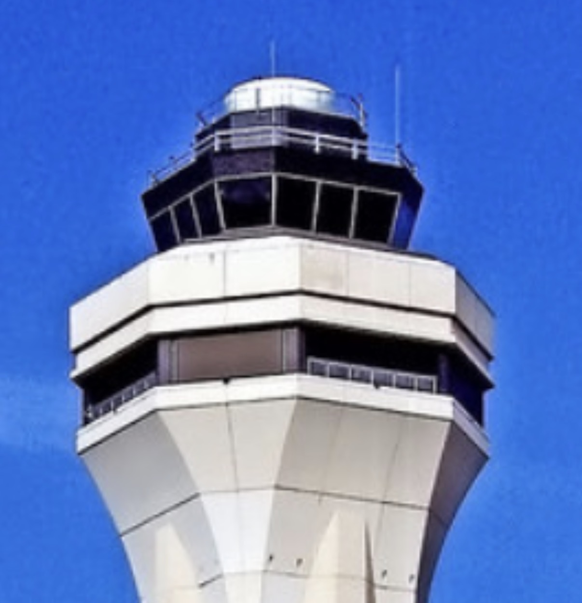
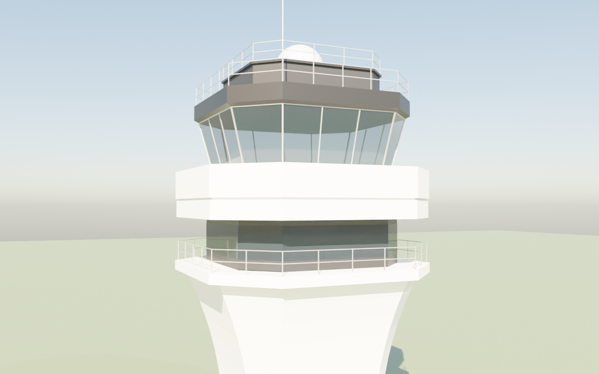
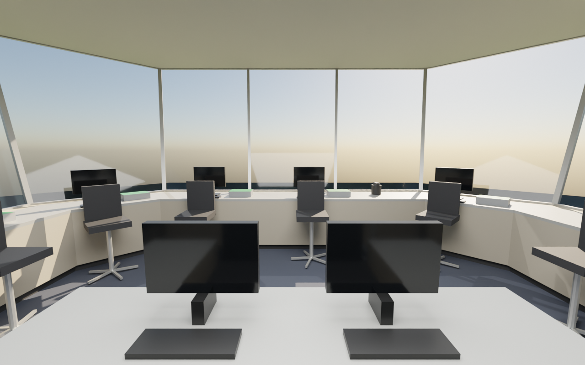

# MIA Style Tower for MSFS 2024

A large-airport control tower for Microsoft Flight Simulator 2024, inspired by the Miami
International (KMIA) tower: an octagonal cab with four main sides, three windows wide each,
joined by one angled window at every corner, all of the glass leaning outward. It is built and
loaded the same way as the VATFLOW KDCA cab in [`msfs-tower/`](../msfs-tower) (a spawnable
"aircraft" made from the SDK's SimpleAircraft sample), so that folder's
[SDK guide](../msfs-tower/SDK-GUIDE.md) applies step for step.

| Reference | Outside | Inside (behind the supervisor desk, looking out of the front window) |
| --- | --- | --- |
|  |  |  |

## What's in the model

* **Cab**: octagon 8.2 m (27 ft) across the main sides at the floor. Main sides 5.4 m wide
  (three 1.8 m windows), corner windows 2.0 m wide, 0.9 m sill, 2.7 m of glass leaning out
  15 degrees, light grey aluminium mullions, dark tinted glass.
* **Above the glass**: a near-black fascia band with a 25 cm overhang, a railed roof, a dark
  set-back penthouse with its own rail, a white radome, and two antenna masts.
* **Below the cab**: the wide white concrete collar (an upper and a lower band with a groove
  between), the recessed dark level with a window band behind a railing, a white ledge, and
  the octagonal shaft flaring out to meet it (about 13.6 m from the cab floor to the bottom of
  the flare).
* **Inside**: carpet, acoustic-tile ceiling with six light panels, consoles round seven of the
  eight windows (the rear main side holds the stair well, with low cabinets either side), and
  the positions laid out from the project's cab layout research
  (`research/tower-cab-interior-layouts.md`, "Miami-style octagonal cab"):

  | Where | Positions |
  | --- | --- |
  | Front side | Local 1 and Ground 1 side by side, light gun |
  | Right side | Local 2 and Ground 2 (second runway complex) |
  | Left side | Clearance Delivery, Flight Data |
  | Front corners | Cab coordinator / assist |
  | Rear corners | Ramp / flow, Class B / VFR radar |
  | Middle | Supervisor and TMC at a U desk facing the front windows |

  Each position has a monitor, radio panel with green keys, keyboard and a tower chair.
* About 2,700 triangles outside and 3,200 inside, plain PBR materials (no textures yet), all
  double sided.

Forward (the SimObject's nose) is the front main side, Blender -Y. Origin = centre of the cab floor.

## Files

| File | What it is |
| --- | --- |
| `blender/build_mia_tower.py` | Builds the tower in Blender from the parameters in `P = { ... }` at the top (side and corner widths, panes per side, glass height and lean, collar, dark level, shaft flare, consoles). Two collections: `MIA_Exterior` and `MIA_Interior`. |
| `tools/export_gltf.py` | Runs the build headless and writes the ready-to-load models with the materials already set the way the sim needs them (no Blender export or MSFS material panel work). |
| `tools/render_preview.py` | Loads the exported glTF files back into Blender and renders `docs/exterior.png` / `docs/interior.png`. |
| `package/SimObjects/Airplanes/mia_tower/common/model/` | `model.cfg`, `mia_tower.xml` / `.gltf` / `.bin` (exterior) and `mia_tower_interior.xml` / `.gltf` / `.bin` (interior), already built. |
| `docs/reference.jpeg` | The reference photo of the Miami tower the model follows. |

## Use it in MSFS 2024

Follow [msfs-tower/SDK-GUIDE.md](../msfs-tower/SDK-GUIDE.md) steps 1, 2, 7 and 8 with these
differences (steps 3 to 6, Blender and its exporter, aren't needed: the model files are
already in this folder):

1. **Model (step 8.1)**: put everything in
   `package/SimObjects/Airplanes/mia_tower/common/model/` into your SimpleAircraft copy's
   `common\model\` (move the sample's own files out first).
2. **Panel (step 8.2)**: skip it for now. This model has no live screens yet.
3. **Eye point (step 8.4)**: standing, 1.0 m (3.3 ft) forward of the cab centre, 5.4 ft up,
   just in front of the supervisor desk. For SimpleAircraft (`reference_datum_position = 3.6, 0, 0`):
   ```
   eyepoint = -0.3, 0, 5.4
   ```
4. **Name (step 8.5)**: `title = "MIA Style Tower"`.
5. **Build All**, start a free flight with it, and place it on the sim's tower like the KDCA
   cab (`msfs-tower/placement/`, or slew mode). The collar and flared shaft hang about 13.6 m
   below the cab floor; to stand it on the ground at an airport with no tower, set
   `shaft_extra_h` to the rest of the tower's height and rebuild.

## Change it and rebuild

Edit `P` in `blender/build_mia_tower.py`, then (Blender 4.5 LTS, or the `bpy` module):

```
blender --background --python tools/export_gltf.py -- package/SimObjects/Airplanes/mia_tower/common/model
blender --background --python tools/render_preview.py -- package/SimObjects/Airplanes/mia_tower/common/model docs
```

Or open the build script in Blender's Scripting tab, run it, and export the two collections
with the MSFS Multi-Exporter as in the SDK guide (step 6), using the material values in
`PBR` in `tools/export_gltf.py`.

## Checked here, and what only the sim can confirm

The model was built with Blender 4.5 (`bpy` module), both glTF files pass the Khronos glTF
validator with no errors or warnings, and they load back into Blender (the preview pictures
are renders of the exported files). Loading it in MSFS 2024 itself hasn't been done yet; the
open points are the same as for the KDCA cab ([SDK guide](../msfs-tower/SDK-GUIDE.md#things-only-the-sim-can-confirm)).

## Next steps

* Live screens on the console monitors (the KDCA cab's DBRITE, TWR INFO and screen host),
  wired through a `panel.cfg` like `msfs-tower/package/.../common/panel/panel.cfg`.
* Textures (concrete, carpet, ceiling tiles), the vertical creases on the shaft, and the
  window shades from the KDCA cab.
