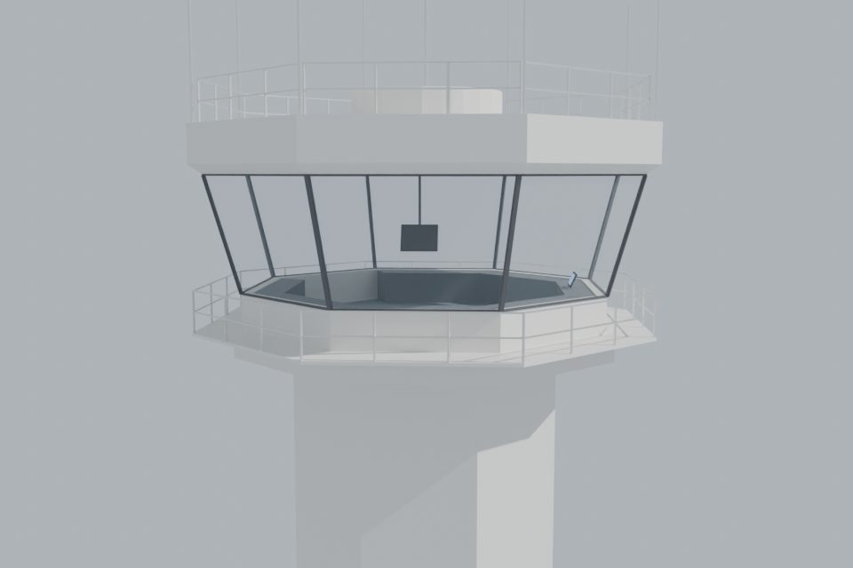
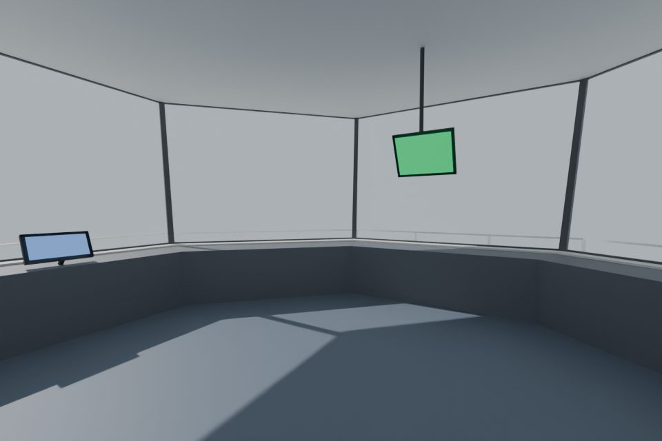
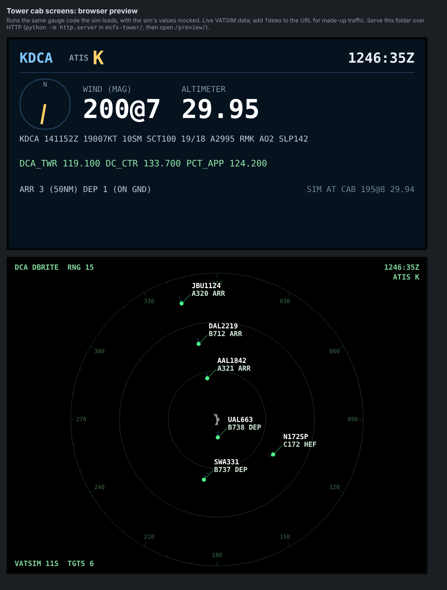

# VATFLOW Tower Cab for MSFS 2024

A spawnable "aircraft" that is really a tower cab, modelled on the Reagan National
(KDCA) tower. You load it in Microsoft Flight Simulator 2024 like a plane at any
airport, it moves itself up onto the sim's own tower and freezes there, and you work
VATSIM traffic from a real tower-cab viewpoint with live VATSIM traffic outside the glass.

* **Any airport**: the cab finds the airport it is at (`common/site.js`) and sets every
  screen up for it: METAR, ATIS, ATC, DBRITE and ASDE-X maps, IDST, VATSMART and the APT
  dashboard. KDCA and KATL ship with their data (`common/airports/`, built by
  `tools/build_airport_data.py`); any other airport gets it from OpenStreetMap the first
  time (`common/osm-airport.js`) and keeps it in the sim's storage. KDCA also has its
  hand-tuned settings (`VATFLOW_TWR_OVERRIDES` in `common/airport.js`) and the ramp screens.
* **Into the tower from inside the sim**: the **TOWER SETUP** screen (any screen's MENU)
  places the cab, moves it with on-screen buttons (forward / back / left / right / up /
  down / turn, three step sizes) and saves the spot for that airport. With AUTO PLACE on
  (the default) the cab goes up by itself a few seconds after a flight starts. Spots come
  from your saved one, else the tower list (`common/towers.js`), else the FAA's position
  of the airport's control tower (US: the FAA Digital Obstacle File, `common/faa-towers.js`
  from `tools/build_faa_towers.py`; the tallest within 2.5 nm, cab floor 15 ft below its
  top, front window facing the airport), else the airport's control tower in
  OpenStreetMap, else the airport centre. `common/placement.js` moves the
  aircraft directly if the sim lets an instrument page set its position, otherwise it
  steers it there in slew mode; then it freezes it, turns the engine off and the ceiling
  lights on. The old Python tool in `placement/` still works as a backup.
* **Screen menu**: every 1024x768 screen runs the screen host (`Screen/`): a MENU tab in its
  bottom-right corner picks the app it shows (DBRITE, ASDE-X, IDST, VATSMART, demand vs
  AAR, aircraft list, the KDCA ramp list and maps, TOWER SETUP). Each screen remembers its
  choice. While the cab isn't in the tower, a banner on the screens leads to TOWER SETUP.
* **Your VATSIM CID** is typed on the TOWER SETUP screen and kept in the sim's storage
  (per user), never in the files, so the package can be shared.

| Outside | Inside (standing eye point) |
| --- | --- |
|  |  |

Inside the cab there are two working screens fed by live data:

* **TOWER RADAR** (the DBRITE; hanging from the ceiling, front right): STARS-style tower
  radar. Live VATSIM traffic within 15 nm, north up, grey range rings, an
  olive video map (runways of every airport in range, airport/heliport/navaid
  symbols), green altimeter list for DCA/ADW/DAA from the METARs, history
  trails and data blocks (callsign / altitude + speed, alternating with type +
  ARR/DEP). Positions are dead-reckoned between feed updates and repainted on a
  4.8 s radar sweep. Zoom (+ / -, down to 4x the range out) and pan (arrows, C = back to
  the whole picture) with the pad in the corner (`common/viewctl.js`, kept per screen).
* **Overhead monitors** hang in square-tube yokes (side knobs, handle bar) from
  trolleys on a circular ceiling track, like the real DCA cab, and are built to travel
  all the way round the cab: grab the screen with the mouse and drag left/right. Drag
  the handle bar under it up/down to raise or lower it (telescoping post, 15 cm up to
  25 cm down), and a side knob left/right to swivel it (up to 50 degrees each way). Every window has a roll-down shade: drag the shade to set its height, click its roller to raise or lower it fully (each shade is 20 strips shown or hidden by its position, no animation) (behaviors in `common/model/tower_cab_interior.xml`, built on the SDK templates `ASOBO_GT_Anim_Code` and `ASOBO_GT_Interaction_DraggingXAxis_Code`).
* **GROUND RADAR** (the ASDE-X; hanging from the ceiling, front left; landscape 4:3 like the DBRITE, turned so
  its top is the view out of the window it hangs in front of, following it round the
  track and its swivel): the DCA surface in ASDE-X
  colours (teal water, grey field, dark movement area, black runways, light
  terminals, from OpenStreetMap) with every VATSIM aircraft on the field and
  arrivals/departures below 2,000 ft as heading arrows with callsign/type. Same zoom / pan
  pad as the DBRITE.
* **Radar traffic: VATSIM or SIM** (`common/traffic.js`): the VATSIM / SIM tab left of MAPS on
  either radar, or TOWER SETUP > TRAFFIC, switches both radars on every screen
  (VatflowStore `TRAFFIC_SRC`). **VATSIM** reads the network feed (about every 15 s,
  dead-reckoned in between). **SIM** reads the aircraft in your own sim once a second
  (`Coherent.call("GET_AIR_TRAFFIC")` after registering `JS_LISTENER_TRAFFIC`, as the SDK's traffic displays do): AI traffic,
  ADS-B / real-traffic injectors, multiplayer, and VATSIM traffic as vPilot shows it. A sim
  aircraft sitting where a VATSIM pilot is (within 0.6 nm / 1,500 ft) gets that pilot's
  callsign, type, route and squawk; others show their ATC id or `TFC` + a number. Ground
  speed is worked out from how far each one moved. The ramp maps always use VATSIM.
* **TWR INFO** (on the front-left console, amber like the IDS): **AW**, the actual
  wind, in big type: the sim's own wind at the cab (2-minute average, magnetic,
  gusts the way a US ASOS / AWOS reports them: a gust is recorded when the 2-minute
  sustained wind is 9 kt or more and the highest 5-second average in the past minute is
  5 kt or more above it, and the highest gust recorded in the past 10 minutes is shown, so
  never under 14 kt). Also the altimeter, Zulu time, the VATSIM ATIS letter and the real
  METAR. Pure black background, so it stays black when dimmed at night.
  **Windshear alert**: when the wind at the cab suddenly gains or loses 15 kt or more (the
  past 5 seconds against the 2-minute sustained wind), the lower half of the screen shows
  WINDSHEAR ALERT and the gain / loss in huge bright red (MICROBURST ALERT for a loss of
  30 kt or more), and an alarm beeps (the sim plays `vatflow_windshear.wav` from the
  cab's sound folder while `L:VATFLOW_WS_ALERT` is 1; see Sound below). It stays up
  until the wind has been steady for a minute. **MUTE** on the screen, or the red button on
  the monitor's bottom bezel (it flashes while the alarm sounds; `L:VATFLOW_WS_ALERT`,
  `L:VATFLOW_WS_MUTE`), silences and hides it until that alert is over.
* **RVR** (any screen's MENU): the FAA's live runway visual range table for the cab's
  airport (rvr.data.faa.gov through the VATFLOW hub's `/hub/rvr`, which adds the CORS header the
  sim needs; read every minute): touchdown / midpoint / rollout in feet with
  trend arrows, amber under 2400 ft, red under 1200 ft, and the edge / centreline light steps.
  US airports with RVR sensors only.
* **IDST** (fixed to the console right of TWR INFO): VATFLOW release times for DCA
  departures in an active FCA program, the same data and release engine as
  vatflow.io/idst.html (`common/vatflow-metering.js` is a bundle of
  `shared/fca-metering.js`, rebuilt with `node msfs-tower/tools/build_vatflow_bundles.mjs`).
  Click an aircraft (or use the four keys next to the keyboard: up, down, issue,
  cancel) and ISSUE RELEASE. Writing needs `idst.cid` in `common/airport.js` set to
  your VATSIM CID, connected as a controller (the web page's rule).
* **Brightness**: the four knobs on the console's knob panel (left to right: all
  screens, DBRITE, ASDE-X, console screens). Drag right for brighter, left for dimmer;
  the screen shows its brightness while you turn (`common/dimmer.js`). The pointers and
  the panel's near edge glow faint amber, so they can be found in the dark. TOWER SETUP has
  the same on buttons: BRIGHTNESS DIMMER / BRIGHTER (the ALL knob); with that knob full up,
  BRIGHTER keeps going to 200 % for bright days (`L:VATFLOW_BOOST`, kept for the next flight;
  the screens glow at twice the SDK's emissive and a black layer normally takes it back).
* **Day / night (AUTO)**: TWR INFO works out the sun's height at the cab from the sim's
  position and time (`VatflowDimmer.master`, `L:VATFLOW_NIGHT`). From dusk the screens dim to
  40 % of their knob setting (AUTO on TOWER SETUP), and with CAB LIGHTS the ceiling lights go
  off and the console task lights come on (night = sun below 0 deg). Both choices are kept.
* **Ceiling lights**: five recessed light panels (softly self-lit) with cabin lights at
  the same spots in `common/config/systems.cfg` (`LIGHT_ASOBO_CabinBounceLarge`, cabin circuits
  1 and 2), switched on by the placement tool.
* **Console task lights**: seven small warm lights (`LIGHT_ASOBO_CabinBounceSmall`, cabin
  circuit 3 = `circuit.40`), one over each console in front of its screens, on at night.
* **TMU desk** in the back-left corner, after the DCA TMU position: three monitors on
  the console (VATSMART, APT Dashboard demand vs AAR, APT Dashboard aircraft list) with keyboards,
  and an oak-edged desk running from the console corner diagonally into the room,
  separating the corner, with the red LED clock and flight strip bays on it.
* **VATSMART** (TMU desk, left screen, `Vatsmart/`): vatflow.io's VATSMART for KDCA
  run in the cab (bundled from the site's own modules into `common/vatflow-smart.js`):
  capacity, demand, queue and TMI tiles, arrivals by landing time per gate, the
  recommendations and the gate MIT plan. Live VATSIM feed, VATFLOW programs (hub),
  NWS forecast and the METAR.
* **APT Dashboard** (TMU desk, middle and right screens, `AptDash/`): the demand vs AAR
  chart (15-minute bins against the program AAR) and the aircraft list (metered order,
  gate, status, ETA / STA, delay and recommended wheels-up) from vatflow.io's APT
  Dashboard for DCA, computed in the cab by `common/apt-flow.js` from the VATSIM feed and
  the VATFLOW program rates (`common/vatflow-hub.js`, read-only).
* **RAMP** (any screen's MENU): the map part of vatflow.io's ramp management page for any
  airport on that page. Pick the airport, then its ramps (tap to add or remove, or ENTIRE
  AIRPORT), then SHOW; the RAMPS tab on the map changes it. Kept per screen. The airport
  list and layouts are read live from vatflow.io (`data/ramp/`), with copies in the package
  (`ramp/<ICAO>.json`, `common/ramp-airports.js`, from `tools/build_vatflow_bundles.mjs`).
  One chart is turned so its top is the view out of that screen's window (north arrow);
  several charts (cargo ramps) sit side by side, north up. A canvas port of ramp.html's map
  (`RampMap/`), same live data as the ramp list (`common/ramp-data.js`). Three console
  screens start on it where vatflow.io has the airport: at KDCA E / D (left of the ramp
  list), C / B and A / Hangars (right of the IDST, front window); elsewhere the airport's
  first three ramps.
* **Ramp list** computer left of the clock (right-hand end of the front-left window):
  the vatflow.io gates page for KDCA (inbound gate proposals, departures on the ground),
  from `shared/ramp-core.js` bundled into `common/vatflow-ramp.js` plus the KDCA layout.
* **Console equipment** round those two, after the DCA local position: voice switch
  panel (keys light while that position is online on VATSIM), red LED Zulu clock,
  keypad, trackball, keyboard, knob panel, speaker. The ceiling is black, like the real cab.
* **Sound**: no aircraft sounds (engine, wind, rattles): `common/sound/sound.xml` has no
  Wwise packages, and the installer moves the sample aircraft's sound folders to
  `backup-sound\` in the project (`tools/silence-sounds.ps1`). The one sound is the
  **windshear alarm**: a plain .wav, `vatflow_windshear.wav` (made by
  `tools/make_alert_sound.py`), next to sound.xml in one of the sim's custom cockpit warning
  slots (WaveData, `WwiseData="False"`, `custom_warning_cockpit_sound_01`), looping while the
  TWR INFO screen sets `L:VATFLOW_WS_ALERT` to 1. No Wwise or extra program needed. The
  Python tool's `3-place-KDCA.bat` can still loop a quiet fan sound
  (`placement/cab_fan.wav`, made by `tools/make_fan_sound.py`).

* **Look** (after photos of a real FAA cab): blue consoles (medium blue laminate worktop, a
  22 cm light grey laminate writing strip along the controller's edge with a dark rounded
  bumper, blue perforated steel vent panels for the computers inside, dark blue kick plinth), the TMU desk in
  the same finish with an oak edge band, charcoal ceiling tiles in a light grey grid with
  round downlights, charcoal grey-blue carpet, a dark band round the ceiling edge, two
  ceiling fans (switch labelled FAN on the TMU desk's open end, `L:VATFLOW_FANS`; they turn only
  while on), overhead monitors on articulated arms (sleeve, elbow, arm, wrist), and a
  laminated quick guide on the TMU desk (how to put / move the cab in the tower; its text is
  `GUIDE` in `tools/make_textures.py`). Textures from `tools/make_textures.py`
  (colours sampled from the photos); one console segment is built and turned round the cab.
  `tools/meshy_retexture.py` can send a part to Meshy's retexture API instead (it suits
  detailed objects better than these flat panels).
* **Props (Meshy text-to-3D)**: a coffee maker on the back-right console by the stairs,
  binoculars on the front console by the window and a propeller cap on the TMU desk's far
  end, each about 4,000-6,000 triangles with 1024 px PBR textures
  (`blender/assets/prop_*.glb` + `TWR_Prop*` textures, made with
  `tools/meshy_retexture.py prop` / `textures`; `prop()` in the Blender script places them).
  The cap's propeller is built in the script (`TowerCab_CapPropeller`) and turns lazily
  while the ceiling fans are on (`L:VATFLOW_CAP_DEG`).
* **FWD placard** low on the front console's front (70 x 35 cm, `TWR_FwdSign`): an arrow up
  towards the front window, the way FWD moves the cab on TOWER SETUP.
* **Woven carpet logo** at the back of the cab in front of the stair hatch: "MADE AND
  POWERED BY VATFLOW TECHNOLOGIES" with an inlay border, dyed into the carpet
  (`TWR_CarpetLogo`: the same carpet texture, mapping and weave with the lettering in lighter
  yarn, so the tiles and ribs run straight through it; `carpet_logo` in make_textures.py and
  the Blender script).
* **Smooth shading**: the exporter shades faces that meet at under 35 degrees as one
  curve (round parts, the Meshy props); box edges, bevels and the cab's 45-degree corners
  stay sharp. Round parts (downlights, fans, knobs, monitor arms) have 16-40 sides.

## Flight strip bays

Three strip bays (TMU, GROUND, LOCAL by default) stand at the front of the consoles, each a
sloped board three columns wide (about 1 m) with its strips drawn on it (`StripBay/`, screens `$SCREEN_STRIPS_1..3`) and a
position name plate on the outer edge of the worktop in front of it (`$SCREEN_SIGN_1..3`).

* **Strips print themselves**: a departure strip (FAA terminal departure strip: ACID,
  type/equipment, CID, revision, beacon code, proposed time, requested altitude, departure
  airport, route ending in the destination, remarks) appears when a pilot with a flight plan
  out of this airport is on the ground here; `VFR` plans show `VFR` (or `VFR/055`) in the
  altitude box, everything else is treated as IFR. Data: the VATSIM feed (bay 1's screen
  reads it every 20 s for all three).
* **Columns**: each separator's section sits in one of the bay's three columns (C1 / C2 / C3
  on the STRIP BAYS screen; by default spread evenly). A bay with no separators fills its
  columns left to right. Default spots: TMU on the left console between the clock cabinet and
  the ramp monitors, GROUND right of the front-right window's centre, LOCAL right of the
  front ramp monitors.
* **Moving strips**: tap a strip to pick it up (any bay), then tap another strip (it goes in
  front of it), a separator (top of that section) or the empty part of a column (bottom).
  PUT BACK, COCK (offset as a reminder) and DELETE act on the strip you hold.
* **Dropping**: strips drop by themselves once airborne (AUTO DROP) or after 3 minutes off the
  network; a deleted strip doesn't print again unless its flight plan is amended.
* **Send to another bay**: with a strip picked up, TO <BAY> buttons (one per other bay, by
  its name: TO GROUND, TO LOCAL ...) put it at the end of that bay's first section.
* **STRIP BAYS screen** (any screen's MENU): each bay's name (its sign), where it stands (any
  console face, and how far along it), and up to six separators typed on the on-screen
  keyboard, each with its column; which bay / section new strips print into; AUTO DROP on / off. Kept per airport.
  The bays move with model animations (`L:VATFLOW_BAY_n_DEG`, `L:VATFLOW_BAY_n_SLIDE`).

Model: `common/strips.js`. The strips don't sync with CRC or vNAS; with other cabs they can (STRIP SYNC, below).

### STRIP SYNC (several cabs, one set of strips)

Controllers in different cabs at the same airport can share their strips: a strip the
ground controller moves to LOCAL turns up on the local controller's LOCAL bay.

* **Turn it on**: TOWER SETUP > STRIP SYNC. One controller taps **NEW** (a random 6-digit
  code) and gives the code to the others; they tap **CODE**, type it and OK. The line shows
  who is in (by CID). **ON** turns it off and on again. Joining a room that is in use
  replaces your strips with the room's; the first cab in starts the room with its own.
* **Shared**: the strips, where they are (bay, section, order), cocked / amended, deleted
  strips (they don't print again for anyone), and the bay setup (names, separators,
  columns, where new strips print, AUTO DROP). **Your own**: the strip you are holding and
  where your bays sit in your cab.
* **How**: the VATFLOW hub's sync rooms (vatflow-hub `cab-sync.js`): the room is the
  airport plus the code, a key per strip / strip position / the bay setup; the hub numbers
  every change and sends it to every cab in the room, so they all end up the same (two
  moves of the same strip at once: the later one wins). Strip bay 1's screen runs it
  (`common/strip-sync.js`); changes you make while the connection is down are sent when it
  comes back. Rooms nobody uses for 12 hours are forgotten.

## ARTCC video maps (the maps CRC shows)

The DBRITE and ASDE-X can show the ARTCC's own vNAS video maps instead of the built-in ones.
They live in a separate Community package, `vatflow-towercab-maps` (`maps-package/`), so
updating the cab never touches them:

1. The ARTCC file (e.g. `ZTL.json`, the vNAS ARTCC configuration) is the one CRC keeps in
   `%LOCALAPPDATA%\CRC` (its `ARTCCs` folder). `update-maps.bat` lists those and copies the
   ones you pick; a `.json` put in the package's `ARTCC files` folder works too, or it can
   download an ARTCC from vNAS (type `ZTL`).
2. Double-click `update-maps.bat`: it puts the file where the cab reads it
   (`html_ui/.../VatflowTower/facilities/`) and rebuilds the package's `layout.json`.
3. In the cab, the **MAPS** tab (next to MENU) on the DBRITE lists the TRACON's STARS maps by
   number plus the tower cab maps: tap to turn them on / off. Presets are named after the
   facility's runway configurations (WEST, EAST ...): SAVE, then a preset, stores what is on;
   a preset switches to its maps. The ASDE-X uses the facility's ASDE-X map by default
   (MAPS picks another). Choices are kept per airport.

Only the ARTCC file is installed; the map drawings are downloaded live from vNAS
(`common/vnas.js`) when a screen shows them. ARTCC files are not kept in this repo, and the
tester zips go out without them: each tester adds their own. The installer copies the package into Community
(`maps-package/install-maps-package.ps1`, which finds the folder from the sim's `UserCfg.opt`).

## Sharing it with friends (one setup EXE)

1. In MSFS open the project, **Clean All**, **Build All**.
2. Double-click `distribution\make-community-zip.bat` in the project. It takes the built
   package from `Packages\`, checks there is no VATSIM CID in it, names it
   `vatflow-towercab` (title "VATFLOW Tower Cab (test)") and writes to your Desktop:
   * **`VATFLOW-TowerCab-Setup.exe`**: the one file to give testers. It holds both
     packages and `distribution/setup/setup.ps1`. The EXE is `distribution/setup/SetupStub.cs`,
     compiled by Windows' own .NET Framework compiler (PowerShell `Add-Type`, nothing to
     install), with the packages appended; it unpacks them to a temp folder and runs the setup.
   * `vatflow-towercab-test.zip` (with install instructions) and `vatflow-towercab-maps.zip`
     (the ARTCC video maps package, no ARTCC files): the same packages, to install by hand.
3. Testers run the setup EXE. It waits until MSFS is closed, finds the Community folder from
   the sim's `UserCfg.opt` (Steam or MS Store; asks which if both, or opens a folder picker if
   neither), replaces any older cab there, adds or updates the maps package (ARTCC files
   already in it stay) and offers to add ARTCC video maps right away (`update-maps`).
   Running it again offers U = update or R = remove. Then: aircraft "VATFLOW Tower Cab", start
   at a parking spot at their airport. No SDK, Python or tools needed.
   The EXE isn't signed, so Windows SmartScreen may say "Windows protected your PC": More
   info > Run anyway.

Don't install the zip on the PC where the project is open in the editor: the sim would
see the cab twice.

Status: everything that can be built without the sim is built and tested here
(the Blender script runs in headless Blender, the screens run in a browser
preview, the placement tool runs against a mocked SimConnect). The parts that
can only be checked inside MSFS 2024 are listed in the
[SDK guide](SDK-GUIDE.md#things-only-the-sim-can-confirm).

## What's in here

| Path | What it is |
| --- | --- |
| [`SDK-GUIDE.md`](SDK-GUIDE.md) | **Start here.** Step-by-step: SDK, Blender, export, build, fly. |
| `blender/build_tower_cab.py` | Builds the cab in Blender from parameters (8 sides, leaning glass, catwalk, roof, antennas, consoles, screens). Run it, export, done. |
| `package/SimObjects/Airplanes/vatflow_tower_cab/common/model/` | `model.cfg` + LOD files that point at the exported cab. |
| `package/SimObjects/Airplanes/vatflow_tower_cab/common/panel/panel.cfg` | Puts the HTML screens onto the screen materials: the screen host (`Screen/S_<id>.html`) on every 1024x768 screen, plus TWR INFO, the clocks and the voice switch. |
| `package/html_ui/Pages/VCockpit/Instruments/VatflowTower/` | The screens. `Screen/` the screen host and its app list, `Setup/` TOWER SETUP, the apps (`Dbrite/`, `Asdex/`, `Idst/`, `Vatsmart/`, `AptDash/`, `Ramp/`, `RampMap/`), `TwrInfo/`, `Clock/`, `Vscs/`; `common/` the shared code: `airport.js` (defaults + per-airport overrides), `site.js` (which airport), `airports/` (bundled airport data), `osm-airport.js`, `towers.js`, `placement.js`, `store.js`, `vatsim-feed.js` ... |
| `placement/` | The older Windows tool (Python + SimConnect): teleport + freeze on the tower, nudge it into place, save. Not needed any more (TOWER SETUP does it in the sim); kept as a backup. |
| `distribution/` | `make-community-zip.bat` / `.ps1`: the Community-folder zip for friends. |
| `tools/make_textures.py` | Generates the interior textures (carpet tiles, black ceiling grid, console laminate, light oak, keypad, keyboard, speaker grille) into `common/texture/`, with the `.png.xml` MSFS compiles them from. |
| `tools/build_vatflow_bundles.mjs` | Bundles VATFLOW code from `shared/` for the screens: the release engine (`common/vatflow-metering.js`, IDST) and the ramp logic (`common/vatflow-ramp.js`) plus `common/ramp-kdca.js` from `data/ramp/KDCA.json`, and every airport on the ramp page (`common/ramp-airports.js`, `ramp/<ICAO>.json`) for the RAMP app. |
| `tools/make_fan_sound.py` | Writes `placement/cab_fan.wav`, the seamless quiet fan loop. |
| `tools/build_faa_towers.py` | Builds `common/faa-towers.js` (every US airport control tower with its height) from the FAA Digital Obstacle File; run it now and then for new towers. |
| `tools/build_airport_data.py` | Builds `common/airports/<ICAO>.js` (runways, control tower, ASDE-X and DBRITE maps) from OpenStreetMap and OurAirports, for airports bundled with the cab. Add one: `python tools/build_airport_data.py KJFK <ourairports-dir> package/html_ui/Pages/VCockpit/Instruments/VatflowTower/common/airports`, then add it to `tools/build_screens.py` (SCRIPTS) and the TWR INFO / VSCS pages. |
| `tools/build_screens.py` | Writes the screen host pages `Screen/S_<id>.html` / `.js` (which screens exist, their default app, which window they look out of). |
| `tools/export_interior_gltf.py` | Builds the cab with the Blender script (headless) and writes `tower_cab_interior.gltf/.bin` directly: static interior plus each overhead monitor as its own node with a `<NODE>_TRACK` 360-degree track animation, materials already set the way the sim needs them. No Blender export or MSFS material panel needed for the interior. |
| `preview/index.html` | Runs the screens in a normal browser with live data, through the same screen host (`?apt=KATL` picks the airport). |

Tests for the screen logic: `node scripts/test-msfs-tower.mjs` (from the repo root).

## Can CRC (or a browser) go inside the cab?

Not CRC itself. MSFS can only draw its own instruments onto 3D screens: small
HTML/JavaScript pages run by the sim's built-in Coherent GT engine (that is how
every glass cockpit works). It cannot show another Windows program such as CRC,
and it is not a general web browser, so CRC can't be mirrored onto a cab screen
(the vatflow.io pages in the cab are rebuilt as instruments from the site's own code).
vNAS TDLS was tried on a cab screen (fix55): the page loads but stays blank (the sim's screen
browser can't run the app), and its VATSIM login refuses to be shown inside another page, so
a login made in a normal browser can't be carried over either. Run TDLS in a normal browser
next to the sim; the cab's own strip bays (with STRIP SYNC) cover strips inside the cab.

What this project does instead:

1. **The DBRITE screen is a radar display built for the cab.** It reads the
   same VATSIM network data CRC shows, straight from the public data feed. The
   one difference: the public feed refreshes every ~15 s while CRC gets
   position updates every few seconds, so the DBRITE dead-reckons in between.
   That is fine for a tower DBRITE, but CRC stays your actual working scope.
2. **Work CRC beside the sim, as real tower controllers do with their
   displays.** Put CRC on a second monitor (or undock its windows) and keep MSFS
   as the out-the-window view. In VR, overlay tools that pin a desktop window
   into the headset (e.g. OpenKneeboard's window capture, or SteamVR overlay
   apps) can float CRC in front of you in the cab.

Anything else in the vatflow data (flow programs, departure lists, etc.) can
become another in-cab screen the same way: a page in
`html_ui/.../VatflowTower/` plus a `[VCockpit]` entry and a screen material
named to match.

## Another airport

Nothing to do: spawn the cab at a parking spot there. The cab finds the airport, the
screens set themselves up, and TOWER SETUP places it on the airport's control tower (the
FAA's position at US airports, else OpenStreetMap's, else the airport centre): nudge it onto the sim's tower
and SAVE. To ship a tuned spot to everyone, add the numbers TOWER SETUP shows to
`common/towers.js`. A tower that is much bigger or smaller than DCA's would need a
resized cab (the parameters at the top of `build_tower_cab.py`).
