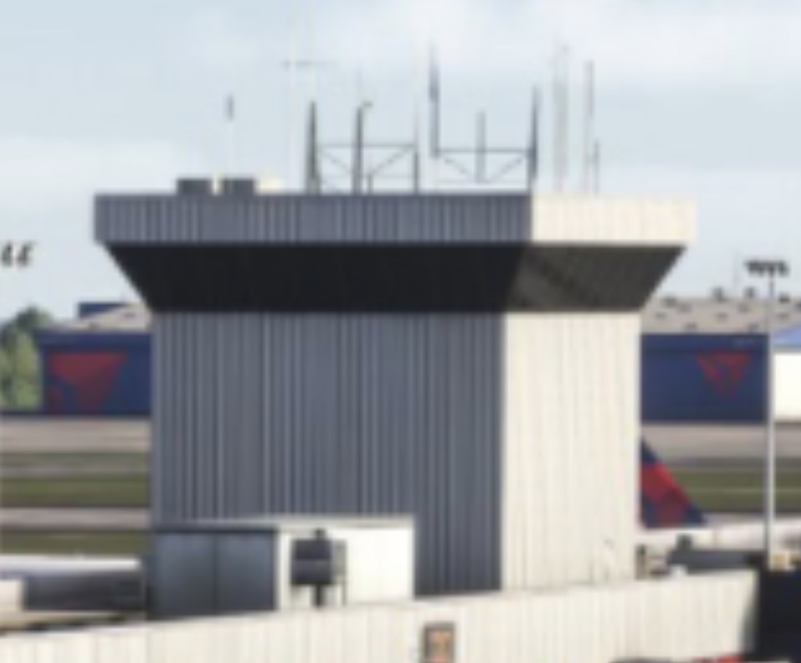
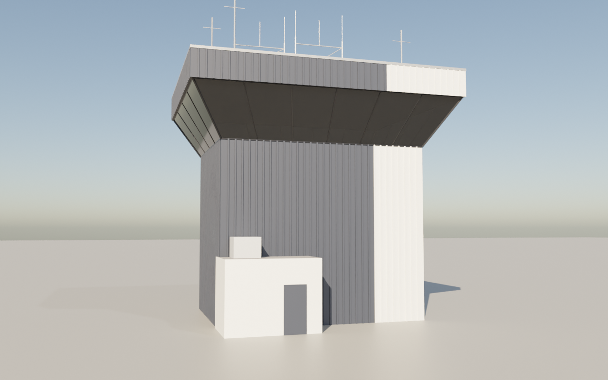
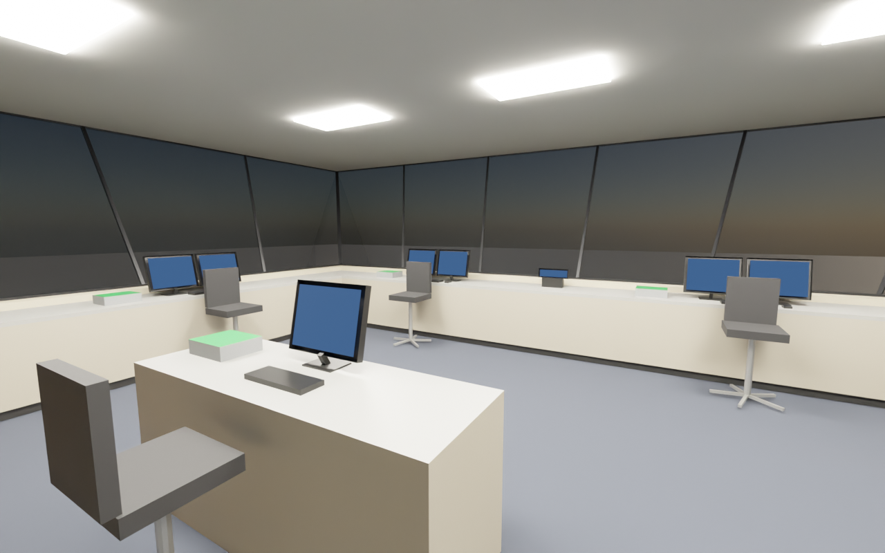

# Ramp Control Tower for MSFS 2024

A basic airline ramp control tower that sits on top of a concourse, like the ramp towers at
Atlanta (KATL): a boxy shaft of ribbed metal cladding rising off the concourse roof, a dark
window band leaning outward on all four sides, and a ribbed roof band on top carrying HVAC
units and antenna masts. Inside there are only consoles and computer screens, set up for
working Ramp with VATFLOW. It is built and loaded the same way as the VATFLOW KDCA cab in
[`msfs-tower/`](../msfs-tower) (a spawnable "aircraft" made from the SDK's SimpleAircraft
sample), so that folder's [SDK guide](../msfs-tower/SDK-GUIDE.md) applies step for step.

| Reference | Outside | Inside (from the stairs, looking out of the front-left corner) |
| --- | --- | --- |
|  |  |  |

## What's in the model

* **Cab**: 10 m wide by 7.5 m deep (33 x 25 ft) at the floor. A 1.0 m cladded sill, then
  2.3 m of dark tinted glass leaning out 32 degrees on every side (the top of the glass is
  1.4 m further out than the bottom), dark mullions about every 1.7 m.
* **Roof band**: 1.25 m of ribbed cladding just past the top of the glass, a dark soffit
  under it, a metal coping, two HVAC units, two H-frame antenna mounts with whips, and three
  single masts.
* **Shaft**: the same ribbed cladding straight down 7.5 m to the concourse roof, dark slate
  with the corner on the right (as you look at the front) in white, like the reference photo.
  A small white stair / elevator annex with a rooftop AC unit stands at its front-left foot.
* **Inside**: carpet, tile ceiling with six light panels, consoles along the front and both
  side windows, a supervisor desk in the middle facing the front, a stair well and coffee
  counter at the back. Each position has two monitors, a keyboard and mouse, a radio panel
  with green keys and a sit-stand chair (console heights and depth from the project's cab
  layout research, `research/tower-cab-interior-layouts.md`).
* **Live VATFLOW screens** (the KDCA cab's screen pages, wired up in `common/panel/panel.cfg`):

  | Where | Position | Screens |
  | --- | --- | --- |
  | Left window | Ramp 1 | ramp list (RAMP), ramp map E / D |
  | Front window, left half | Ramp 2 | ramp map C / B, ground radar (ASDE-X) |
  | Front window, right half | Ramp 3 | ramp map A / Hangars, tower radar (DBRITE) |
  | Front window, middle | | clock |
  | Right window | Ramp coordinator | VATSMART, airport demand |
  | Middle, rear | Supervisor | airport list |

  Every 1024x768 screen runs the KDCA cab's screen host, so the MENU tab in its corner
  switches it to any other VATFLOW app. The ramp maps turn to the window they face the same
  way as in the KDCA cab (ramp list and E / D map on the left window, C / B and A / Hangars
  on the front).
* About 4,000 triangles outside and 3,100 inside, plain PBR materials (no textures yet), all
  double sided.

Forward (the SimObject's nose) is the front window, Blender -Y; left is +X. Origin = centre of
the cab floor.

## Files

| File | What it is |
| --- | --- |
| `blender/build_ramp_tower.py` | Builds the tower in Blender from the parameters in `P = { ... }` at the top (cab size, shaft height, glass height and lean, roof band, where the white cladding starts, consoles). Two collections: `RAMP_Exterior` and `RAMP_Interior`. |
| `tools/export_gltf.py` | Runs the build headless and writes the ready-to-load models with the materials already set the way the sim needs them, screens included (no Blender export or MSFS material panel work). |
| `tools/render_preview.py` | Loads the exported glTF files back into Blender and renders `docs/exterior.png` / `docs/interior.png`. |
| `package/SimObjects/Airplanes/ramp_tower/common/model/` | `model.cfg`, `ramp_tower.xml` / `.gltf` / `.bin` (exterior) and `ramp_tower_interior.xml` / `.gltf` / `.bin` (interior), already built. |
| `package/SimObjects/Airplanes/ramp_tower/common/panel/panel.cfg` | Puts the VATFLOW pages on the ten screens. |
| `docs/reference.jpeg` | The reference photo of the ATL ramp tower. |

## Use it in MSFS 2024

Follow [msfs-tower/SDK-GUIDE.md](../msfs-tower/SDK-GUIDE.md) steps 1, 2, 7 and 8 with these
differences (steps 3 to 6, Blender and its exporter, aren't needed: the model files are
already in this folder):

1. **Model (step 8.1)**: put everything in
   `package/SimObjects/Airplanes/ramp_tower/common/model/` into your SimpleAircraft copy's
   `common\model\` (move the sample's own files out first).
2. **Panel (step 8.2)**: copy `package/SimObjects/Airplanes/ramp_tower/common/panel/panel.cfg`
   into `common\panel\`.
3. **Screens (step 8.3)**: the screen pages are the KDCA cab's. Copy
   `msfs-tower/package/html_ui` into the project and add the `html_ui` Copy asset group
   exactly as step 8.3 says.
4. **Eye point (step 8.4)**: standing, 1.2 m (3.9 ft) forward of the cab centre, 5.4 ft up,
   behind the Ramp 2 and Ramp 3 chairs. For SimpleAircraft (`reference_datum_position = 3.6, 0, 0`):
   ```
   eyepoint = 0.3, 0, 5.4
   ```
5. **Name (step 8.5)**: `title = "Ramp Control Tower"`.
6. **Build All**, start a free flight with it, and place it on the concourse like the KDCA cab
   (`msfs-tower/placement/`, or slew mode). The shaft hangs 7.5 m below the cab floor; set
   `shaft_h` to the height above the concourse roof you want and rebuild.

## Change it and rebuild

Edit `P` in `blender/build_ramp_tower.py`, then (Blender 4.5 LTS, or the `bpy` module):

```
blender --background --python tools/export_gltf.py -- package/SimObjects/Airplanes/ramp_tower/common/model
blender --background --python tools/render_preview.py -- package/SimObjects/Airplanes/ramp_tower/common/model docs
```

Or open the build script in Blender's Scripting tab, run it, and export the two collections
with the MSFS Multi-Exporter as in the SDK guide (step 6), using the material values in
`PBR` in `tools/export_gltf.py` (screens: emissive 4000, as in the KDCA cab).

## Checked here, and what only the sim can confirm

The model was built with Blender 4.5 (`bpy` module) and loads back into Blender (the preview
pictures are renders of the exported files; the screens show as plain dark blue there,
since only the sim draws the VATFLOW pages). Both glTF files pass the Khronos glTF validator
except for the screens' and light panels' emissive values above 1, which MSFS uses on
purpose (the KDCA cab's screens are the same). All ten screen faces point at their
controller and carry 0..1 UVs in TEXCOORD_0 and TEXCOORD_1 like the SDK GaugeAircraft
sample. Loading it in MSFS 2024 itself hasn't been done yet; the open points are the same as
for the KDCA cab ([SDK guide](../msfs-tower/SDK-GUIDE.md#things-only-the-sim-can-confirm)).

## Next steps

* Textures for the ribbed cladding, carpet and ceiling, and the KDCA cab's window shades.
* Brightness knobs and strip bays from the KDCA cab, if the ramp positions want them.
